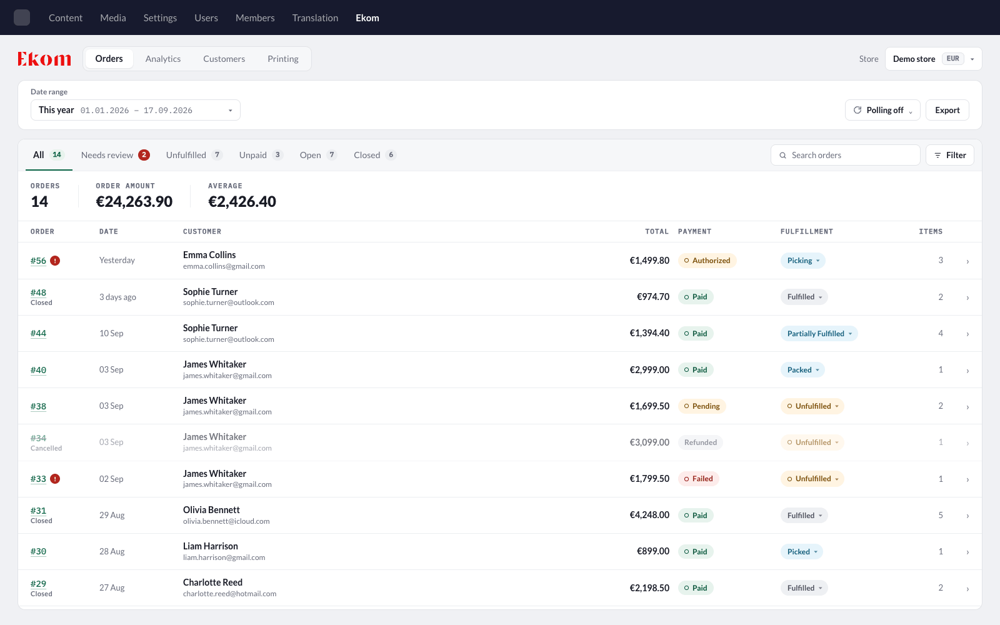
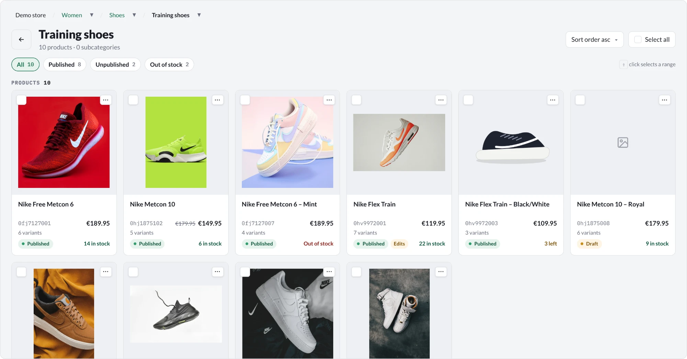
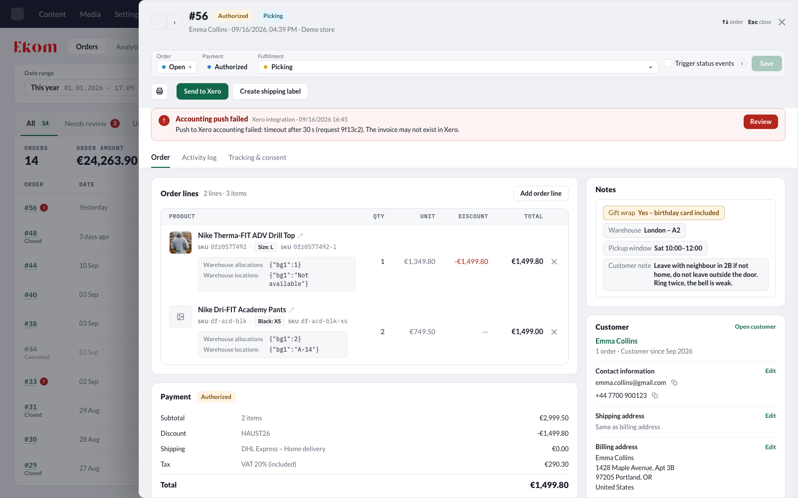

# Ekom

[](https://www.nuget.org/packages/Ekom.U17/)
[](https://www.nuget.org/packages/Ekom.U18/)
[](https://www.nuget.org/packages/Ekom.U19/)
[](https://www.nuget.org/packages/Ekom.U10/)
[](https://github.com/Vettvangur/Ekom/blob/Ekom/LICENSE)

Ekom is a free, open-source e-commerce package for Umbraco. The catalog is Umbraco content, so editors manage products where they already work. Orders, customers and analytics are handled in a manager inside the backoffice.

**Documentation:** [vettvangur.gitbook.io/ekom](https://vettvangur.gitbook.io/ekom)

**Product website:** [ekomcommerce.com](https://www.ekomcommerce.com/)



## What Ekom does

### Catalog

- [Products, variants and categories](https://vettvangur.gitbook.io/ekom/guides/catalog-and-products) as Umbraco content, with a catalog view that shows price, stock and publish state on every card
- [Several stores](https://vettvangur.gitbook.io/ekom/guides/stores) in one site, each with its own languages, currencies and catalog
- [Imports](https://vettvangur.gitbook.io/ekom/guides/imports) that keep products, prices and stock in step with an ERP system
- [Database price storage](https://vettvangur.gitbook.io/ekom/guides/database-price-storage), so frequent price updates go live without publishing a product



### Selling

- [Baskets and orders](https://vettvangur.gitbook.io/ekom/guides/orders-and-baskets) for consumers and for business customers
- [Checkout](https://vettvangur.gitbook.io/ekom/guides/checkout) with payment and shipping [providers](https://vettvangur.gitbook.io/ekom/guides/providers) that you set up as content
- [Discounts](https://vettvangur.gitbook.io/ekom/guides/discounts) on products, orders and quantities, and coupons with usage limits
- [Stock](https://vettvangur.gitbook.io/ekom/guides/stock) with [reservations](https://vettvangur.gitbook.io/ekom/guides/reservations), so two customers cannot buy the last item

### Payments, shipping and orders

- [Ten payment gateways](https://vettvangur.gitbook.io/ekom/payments), each one package, and offline payments without any
- [Every payment attempt recorded on its order](https://vettvangur.gitbook.io/ekom/guides/payments): provider, transaction ID, authorization code and card, with the payment status worked out from what the gateway reported
- [Shipments](https://vettvangur.gitbook.io/ekom/guides/shipping) with tracking numbers on the order, entered by staff or booked with a carrier
- [Separate order, payment and fulfillment statuses](https://vettvangur.gitbook.io/ekom/guides/order-statuses), so an order can be paid but not yet shipped
- [Order reviews](https://vettvangur.gitbook.io/ekom/guides/order-reviews) that flag orders a person must look at, such as a payment that does not match its order

### Manager

- [Orders](https://vettvangur.gitbook.io/ekom/manager/orders): search, filter, change statuses, edit order lines and export to CSV
- [Customers](https://vettvangur.gitbook.io/ekom/manager/customers) and [analytics](https://vettvangur.gitbook.io/ekom/manager/analytics) for the same orders
- An [activity log](https://vettvangur.gitbook.io/ekom/manager/activity-logs) on every order, and [access per store](https://vettvangur.gitbook.io/ekom/manager/access-and-permissions)



### Integrating and extending

- [Headless APIs](https://vettvangur.gitbook.io/ekom/guides/headless) for catalog, basket, checkout and orders
- [GA4 and Meta tracking](https://vettvangur.gitbook.io/ekom/guides/tracking-and-consent) with consent handling
- [Events](https://vettvangur.gitbook.io/ekom/reference/events) and [services](https://vettvangur.gitbook.io/ekom/reference/services-and-dependency-injection) for your own pricing, stock rules, search and manager actions
- [Working code examples](https://vettvangur.gitbook.io/ekom/examples) for event handlers, your own product classes, imports, storefront pages and background jobs

## Requirements

Install the runtime package and the web-assets package of the row that matches your Umbraco version, with the same version number.

| Umbraco | .NET | Runtime package | Web-assets package |
| --- | --- | --- | --- |
| 17 | 10 | `Ekom.U17` | `Ekom.Web.U17` |
| 18 | 10 | `Ekom.U18` | `Ekom.Web.U18` |
| 19 (release candidate) | 11 | `Ekom.U19` | `Ekom.Web.U19` |
| 13 | 8 | `Ekom.U10` | `Ekom.Web` |

The documentation covers Umbraco 17, 18 and 19. `Ekom.U10` is the retained package name for the Umbraco 13 integration. It does not support Umbraco 10.

See [Compatibility](https://vettvangur.gitbook.io/ekom/getting-started/compatibility) for the exact Umbraco versions each package accepts.

## Get started

1. Install both packages in the site's main project, the one that contains `wwwroot`. On Umbraco 17:

   ```bash
   dotnet add package Ekom.U17
   ```

   ```bash
   dotnet add package Ekom.Web.U17
   ```

2. Start the site. Ekom registers itself through its Umbraco composer, so there is no setup code; do not call `AddEkom(...)` yourself. On the first start it creates its database tables, data types, document types and the **Ekom** root content node.
3. In the backoffice, add the **Ekom** section to your user group.
4. Create and publish a store, then a category and a product.

The [installation guide](https://vettvangur.gitbook.io/ekom/getting-started/installation) and the [quick start](https://vettvangur.gitbook.io/ekom/getting-started/quick-start) take you from an empty Umbraco site to a product in a basket.

## Payment gateways

Offline payments, such as bank transfer or pay on pickup, work with Ekom alone. Each online gateway is one package from the [Ekom.Payments repository](https://github.com/Vettvangur/Ekom.Payments) that the site references itself:

```bash
dotnet add package Ekom.Payments.Stripe
```

| Gateway | Package |
| --- | --- |
| [Stripe](https://vettvangur.gitbook.io/ekom/payments/stripe) | `Ekom.Payments.Stripe` |
| [PayPal](https://vettvangur.gitbook.io/ekom/payments/paypal) | `Ekom.Payments.PayPal` |
| [Borgun (Teya cards)](https://vettvangur.gitbook.io/ekom/payments/borgun) | `Ekom.Payments.Borgun` |
| [Valitor](https://vettvangur.gitbook.io/ekom/payments/valitor) | `Ekom.Payments.Valitor` |
| [Straumur](https://vettvangur.gitbook.io/ekom/payments/straumur) | `Ekom.Payments.Straumur` |
| [Netgiro](https://vettvangur.gitbook.io/ekom/payments/netgiro) | `Ekom.Payments.Netgiro` |
| [Siminn Pay](https://vettvangur.gitbook.io/ekom/payments/siminn-pay) | `Ekom.Payments.SiminnPay` |
| [Teya Consumer Loans](https://vettvangur.gitbook.io/ekom/payments/teya-consumer-loans) | `Ekom.Payments.TeyaConsumerloans` |
| [AltaPay](https://vettvangur.gitbook.io/ekom/payments/altapay) | `Ekom.Payments.AltaPay` |
| [PayTrail](https://vettvangur.gitbook.io/ekom/payments/paytrail) | `Ekom.Payments.PayTrail` |

The gateway packages need Ekom 1.2 or later. A gateway that has no package can be [written in a site project](https://vettvangur.gitbook.io/ekom/payments/write-your-own).

## Optional packages

| Package | Adds |
| --- | --- |
| [Ekom.Algolia](https://github.com/Vettvangur/Ekom/tree/Ekom/Plugins/Ekom.Algolia) | Product, category and content indexing, and product search through Algolia |
| [Ekom.Klaviyo](https://github.com/Vettvangur/Ekom/tree/Ekom/Plugins/Ekom.Klaviyo) | Order events and catalog synchronization with Klaviyo |
| [Ekom.Mailchimp](https://github.com/Vettvangur/Ekom/tree/Ekom/Plugins/Ekom.Mailchimp) | Mailchimp audience tags, subscriptions, purchase tracking and transactional messages |
| [Ekom.Printer](https://github.com/Vettvangur/Ekom/tree/Ekom/Ekom/Printing/Ekom.Printer) | Automatic picking-slip printing through a [Windows agent](https://github.com/Vettvangur/Ekom/tree/Ekom/Ekom/Printing/Ekom.Printer.Agent) |

Each package states the Ekom and Umbraco versions it supports. Check them before you upgrade Ekom or Umbraco. See [Integrations](https://vettvangur.gitbook.io/ekom/integrations).

## Documentation

| Section | Read it when you want to |
| --- | --- |
| [Getting started](https://vettvangur.gitbook.io/ekom/getting-started) | Install Ekom on a site for the first time. |
| [Guides](https://vettvangur.gitbook.io/ekom/guides) | Build one part of a store, such as checkout or discounts. |
| [Payment gateways](https://vettvangur.gitbook.io/ekom/payments) | Set up Stripe, PayPal or another gateway. |
| [Examples](https://vettvangur.gitbook.io/ekom/examples) | Copy working code for a common task. |
| [Reference](https://vettvangur.gitbook.io/ekom/reference) | Look up a setting, method, event or endpoint. |
| [Manager](https://vettvangur.gitbook.io/ekom/manager) | Work with orders and customers in the backoffice. |
| [Upgrading](https://vettvangur.gitbook.io/ekom/upgrading) | Move a site to a newer Umbraco or Ekom version. |
| [Architecture](https://vettvangur.gitbook.io/ekom/architecture) | Understand how Ekom is put together. |

The same pages are in the [`docs` folder](https://github.com/Vettvangur/Ekom/tree/Ekom/docs) of this repository, which is where they are edited.

## Help and contributing

Report bugs and ask questions in [GitHub issues](https://github.com/Vettvangur/Ekom/issues).

To work on Ekom itself, see [Set up a development environment](https://vettvangur.gitbook.io/ekom/contributing/setup) and [Build, test and release](https://vettvangur.gitbook.io/ekom/contributing/build-test-release). The release history is in [`Ekom/CHANGELOG.md`](https://github.com/Vettvangur/Ekom/blob/Ekom/Ekom/CHANGELOG.md).

## License

Ekom is available under the [MIT License](https://github.com/Vettvangur/Ekom/blob/Ekom/LICENSE).
